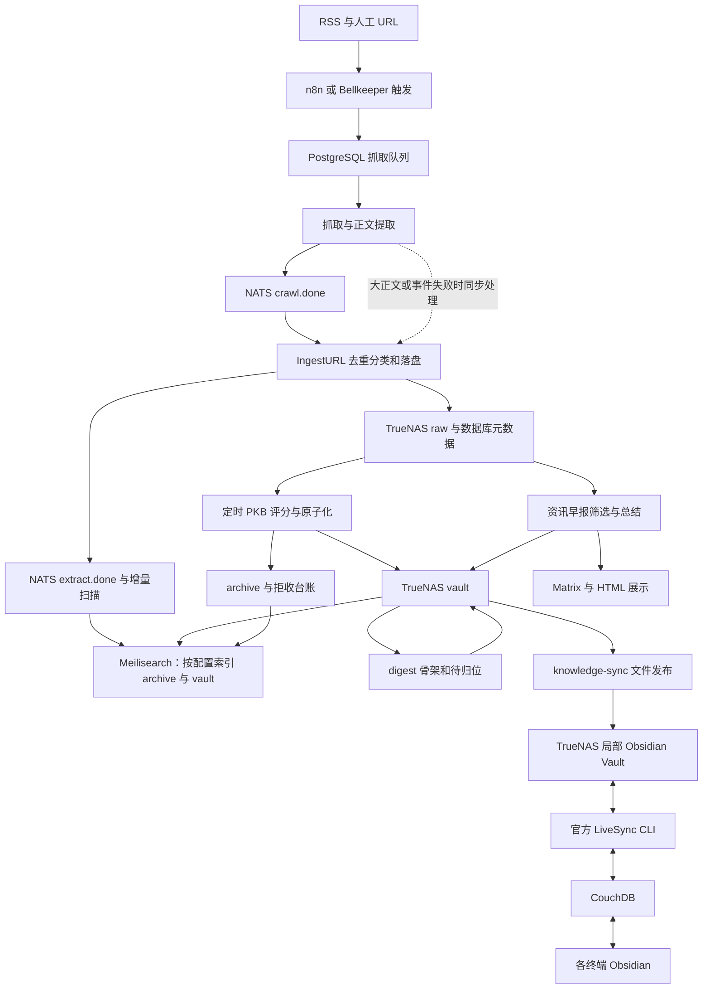
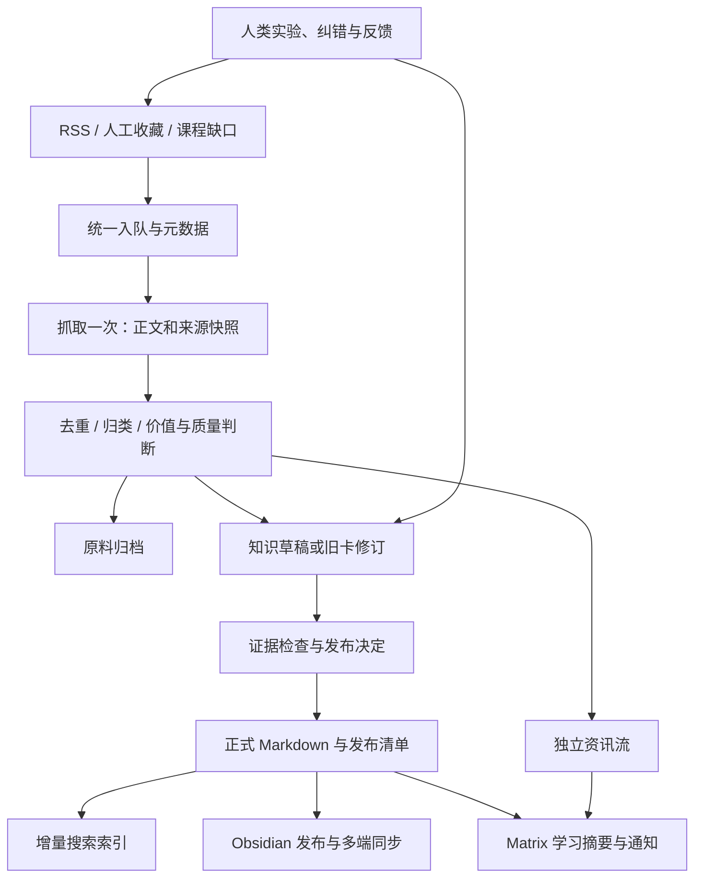

# 知识系统评审与改进建议：安全研究与工程实践

> 日期：2026-10-30。状态：待评审建议，尚未实施。
>
> 本次只新增本文。未调整生产配置、工作流、提示词、知识文件、Obsidian 目录或同步方向。
>
> 范围：Bellkeeper 内容采集、筛选、知识整理、检索与展示，n8n/Matrix 调度和通知，TrueNAS 文件存储，以及 knowledge-sync → LiveSync → Obsidian 发布链路。学习目标按用户确认的“安全研究与工程实践”评估。

## 1. 结论与优先决策

现有系统已经具备可用的采集、原子知识卡生产、检索、通知和多端同步底座，但**尚不能作为零基础、递进、可验证的完整安全工程学习体系**。当前主要矛盾是输入多、知识点分散、质量依据不足、课程入口薄弱，而非采集源不够。

建议优先确定五件事：

1. **学习主线由能力目标驱动。** 保留现有技术资讯范围，新增一条“基础 → Web/API 安全 → 代码审计 → 修复与检测 → 研究复盘”的主线；Windows/AD、二进制、移动端、云和 AI 安全作为后续分支。
2. **建立正式发布门槛。** 抓取成功、生成成功、来源支持、实验成功、适合教学是不同结论，不能共用一个“已核实”标记。
3. **原子卡继续保留，补上教程和实验。** 短卡适合查阅；学习还需要前置知识、完整示例、预期结果、失败排查和考核。
4. **统一正式内容，分离工具职责。** Bellkeeper 负责采集、加工、审查、检索；Obsidian 负责阅读、学习和个人写作。CouchDB 继续只承担 LiveSync 协议同步，不升级为知识业务数据库。
5. **先治理再合并文件副本。** 当前两份生成稿提供写入隔离和冲突保护，短期有价值；最终应有一份明确的正式 Markdown，搜索与终端都读取这份内容。不要为了节省约 10 MB 立即移动整个库。

建议顺序：**发布与统计纠偏 → 小规模学习主线 → 定期复核闭环 → 流程简化与正式库统一 → 扩展学习分支**。

## 2. 证据范围与当前事实

### 2.1 本次怎样评审

- 阅读 Bellkeeper 状态、知识库设计、模板、每周整理 SOP、领域配置、当前启用提示词，以及采集、入库、PKB、早报、索引、展示代码。
- 阅读 SilkSpool knowledge-sync 发布器、守护进程与部署契约。
- 通过 PATH 中的 `spool exec prod` 读取生产 API、非敏感运行设置、挂载信息和生成文件；未调用生成、重建、通知、重试等会改变业务状态的接口。
- 对生产 `knowledge/vault` 的 **2,548 个 Markdown** 做结构扫描；对 **20 张安全卡**按文件名排序后等距抽样阅读，并检查四个领域索引及待归位文件的结构和部分正文。
- 用官方规范核对部分具体技术说法，作为质量问题的例证；未逐条验证全部知识卡。

代码基线：SilkSpool `856e087`，Bellkeeper `e8a984c`。主要生产快照采于 2026-10-30 16:22 起（Asia/Shanghai）；随后读数可能随后台任务增长。

本次没有读取两台电脑的完整个人 Vault，也没有验证每台终端此刻的界面、插件或学习体验。用户已确认两台电脑同步正常；本次额外确认的是服务器发布状态。以下明确区分生产观察、代码行为和改进建议。

### 2.2 生产内容与存储

| 项目 | 本次观察 | 解读 |
|---|---:|---|
| NAS `raw` Markdown | 53,334 | 文件资产数量，不等于数据库待处理数量 |
| NAS `archive` Markdown | 585 | 归档/筛选输出，具有不同用途 |
| NAS `working` Markdown | 5 | 不包含 `vault/SilkSecAgent` 等其他位置的过程文档 |
| NAS `vault` Markdown | 2,548，10,247,364 字节 | 当前生成内容发布源 |
| NAS `obsidian/20-PKB/Bellkeeper` Markdown | 2,548，同等总字节数 | 发布目标；数量和体积相同不单独证明逐文件内容相同 |
| LiveSync 服务状态 | ready，pending=0，conflicts=0，remoteFiles=2548 | 路径、大小、修改时间等同步检查通过，不代表内容审查通过 |
| Meilisearch 文档数 | 37,508 | **索引分块数**，不是独立笔记数 |
| 数据库 raw 列表 | 2,585 条，其中未处理 2,563 条 | API 排除了标签关联占位行；仍需与文件清单按身份对账 |
| RSS 配置 | 77 个 active，其中 1 个 paused | 活跃配置不代表全部正在成功采集 |
| 抓取队列快照 | pending 2,557；success 234；skipped 4,512；retrying 5 | 队列累计状态，不可直接当作每日吞吐或质量通过率 |

`knowledge` 挂载读取结果为 TrueNAS NFSv4.1、`rw,hard`；knowledge-sync 对发布源使用只读挂载，对局部 Obsidian Vault 使用可写 NFS。读写隔离方向合理。本次没有重新执行写入压测；此前挂载读写验收不能替代后续定期恢复演练。

生成内容顶层分布为：AI 881、编程 876、安全 374、基础 145、SilkSecAgent 191、资讯 68、其他 13。AI 与编程合计约 **69%**，安全约 **15%**；这不是质量评分，但说明库存结构未围绕当前学习目标组织。

### 2.3 卡片质量与导航现状

采用独占行 `---` 划分 frontmatter，并用标准 YAML 解析器扫描：

| 指标 | 全生成库 | 安全子集 |
|---|---:|---:|
| 可解析且 `type=pkb_card` | 1,924 | 298 |
| 有来源字段 | 1,924 | 298 |
| 四段标准章节齐全 | 1,924 | 298 |
| 正文字数中位数，按 Unicode 字符计 | 约 1,074 | 约 1,018 |
| 有 `verification` | 224 | 16 |
| 缺少 `verification` | 1,700 | 282 |
| 明确 `verified` | 119 | 10 |
| 明确 `unverified` / `llm-only` | 85 / 20 | 4 / 2 |
| 有结构化 `prerequisites` / `learning_objectives` / 难度字段 | 0 | 0 |
| 有 `last_reviewed` / `next_review_at` / `tested_versions` | 0 | 0 |

全库另有 **23 个文件的 frontmatter 无法通过标准 YAML 解析**；527 个文件未被识别为带有 `type` 的文档，包含旧格式及解析异常，不能全部称为坏文件。日期、`score`、`domains`、`tags` 的类型也存在字符串、数组、映射等混用。

缺少核实字段不等于内容错误；有 `verified` 也不等于已经实验验证。部分卡片正文写有前置关系，旧文档也有 Lab/周审模板，因此不能说“完全没有学习和审查设计”。缺失的是统一数据契约及持续执行的证据。

生产 `/api/pkb/domains/stats` 显示：

| 领域 | 接口卡片数 | 待归位条目 | 索引文件最近修改时间 |
|---|---:|---:|---|
| 编程 | 697 | 685 | 10-29 |
| 安全 | 307 | 303 | 10-15 |
| 基础 | 93 | 93 | 10-15 |
| AI | 669 | 638 | 10-13 |

**不能把这张表直接计算成课程覆盖率。** 接口只扫描领域顶层、排除下划线文件，使用自己的 frontmatter 解析；待归位数来自列表含链接行，可能陈旧。它与标准 YAML 全树扫描的口径不同。代码还以知识树中的 `[[` 数量作为“已填节点”计数，而生产树里大量节点是普通文本。这些差异本身就是需要修正的可观测性问题。

安全 `_index.md` 约 2.37 万字符、651 行；`_待归位.md` 约 7.04 万字符。如此长的目录和未归位清单适合作为后台审查材料，难以充当初学者首页。

生成库内发现 5,605 处 wikilink，按文件名及路径近似检查，有 **356 处未找到目标文件的候选问题**。该数字未考虑个人库其他目录、完整 Obsidian 解析规则和标题锚点，不能直接宣称 356 个确定死链。已看到的具体问题包括：

- 链接写成 `[[攻防安全目标知识索引]]`，实际文件是 `安全/_index.md`。
- 链接使用概念名，文件名却多了下划线或经过截断。
- 关系章节有普通文本概念名，未真正生成链接。

### 2.4 哪些自动维护已运行

| 能力 | 代码/文档具备 | 本次生产结论 |
|---|---|---|
| 去重、分类、评分、原子化 | 是 | 正在运行 |
| 自动 curate | 是 | `feature_pkb_auto_curate=true`，间隔 360 分钟 |
| 每轮图谱健康摘要 | 是 | 配置 `audit_on_run=true` |
| 自动补缺口 | 是 | 对应全局调度开关未配置，默认关闭；领域配置仅 programming 开启 |
| 自动资讯晋升 | 是 | 对应调度开关未启用；早报生成是另一条已启用链路 |
| 自动骨架提议 | 是 | 对应调度开关未启用 |
| 过期内容复核、事实纠错闭环 | 有部分人工模板 | 未发现统一的到期任务、复核履历和发布撤回闭环 |
| 学习结果回流 | 人工 SOP 有设想 | 未发现“实验/考核结果 → 缺口排序 → 内容修订”的运行闭环 |

不能用“有 fill/propose 命令”来说明系统已经在自我完善。也不建议直接打开全部开关：现有质量、导航和状态口径问题会随自动生成规模一起放大。

## 3. 内容是否适合工程师成长

### 3.1 现有优点

原子卡的四段结构覆盖定义、细节、边界、关系，比单纯文章摘要更便于复用；评分已考虑长期价值并抑制营销和泛资讯；有拒收台账、语义去重、知识骨架、缺口标记、快照及人工提议机制。

人工文档中的 Lab 模板已经要求环境、版本、前置条件、步骤、结果和参考资料；每周 SOP 也要求理解之后再沉淀。这些应该接入实际生产规范，不必另造一套完全不同的体系。

### 3.2 主要不足

| 维度 | 结论 | 对学习的影响 |
|---|---|---|
| 零基础 | 不足 | 多数卡默认读者理解协议、运行时、权限和工具；正文前置关系不能替代入门教程 |
| 递进 | 不足 | 树状归类表达“属于哪类”，不等于“先学什么、达到什么结果再继续” |
| 完整性 | 未建立可验证标准 | 有主题树，但没有确定的能力清单、必修节点和实验覆盖矩阵 |
| 正确性 | 有来源追溯，验证不足 | 来源可能错，抽取可能丢条件，模型可能把个案泛化 |
| 实践性 | 有命令与方法，闭环不足 | 环境版本、预期输出、修复后回归和失败分析不稳定 |
| 时效性 | 不足 | 入库时间不能说明技术适用时间；缺乏复核期限和替代版本关系 |
| 可读性 | 部分合格 | 中英文混合、超长索引、概念与路径漂移增加阅读成本 |
| 自我成长 | 局部机制，尚未闭环 | 产量和连边增加不等于能力提升，也不能证明内容越来越正确 |

评分对深度、新颖性的偏好可能让基础资料吃亏。对初学者而言，HTTP、权限模型、进程与内存、数据库事务等“并不新颖”的内容反而是关键。课程必需内容应单独评价教学完整性，不能与热点文章争同一个总分排名。

### 3.3 抽样中发现的具体问题

以下仅证明存在需要治理的问题，不用于估算全库错误率。

| 生成卡片 | 观察与判断 | 建议处理 |
|---|---|---|
| `安全/AS-REP Roasting.md` | 有概念和操作提示，但没有完整 Kerberos/AD 入门、固定实验环境、结果与防御验证 | 作为进阶参考，连接到前置教程和实验，不直接充当零基础教材 |
| `安全/Java内存马热加载清除.md` | 将 `return true;` 与 Filter 放行逻辑并列；标准 `Filter.doFilter` 返回 `void`，不能这样替换 | 纠正具体方法签名与调用链；补编译验证、适用版本和处置边界 |
| `安全/Git历史硬编码密钥挖掘.md` | 把对 `node_id:ts` 的自定义 HMAC 签名称为 JWT 构造，未采用 JWS 所规定的签名输入结构 | 区分“自定义签名令牌”和 JWT/JWS；用规范及最小验证样例复核 |
| `安全/CSS 键盘记录攻击.md` | 已标 unverified 仍位于发布区；对输入当前值、HTML value 属性和框架行为的条件说明不足 | 分清 DOM property 与 content attribute，固定浏览器/框架条件实测后再写结论 |
| `安全/TrueConf Server 双 CVE 链式利用.md` | 前文称链条需要两个漏洞同时成立，后文又称只修其一无法切断；就文内给定逻辑而言相互矛盾 | 返回厂商通告核对独立攻击路径；本次未核验这些 CVE 的真实性和版本，不能采信修复结论 |
| `安全/Windows BootKey 低权限提取.md` | “无需管理员”“不触发 EDR”等宽泛结论缺少系统构建、产品策略、账号权限和实验记录 | 改成有版本和环境边界的实验结论，避免个案升级为普遍保证 |

技术核对依据：Apache Tomcat 的 [Servlet Filter API](https://tomcat.apache.org/tomcat-9.0-doc/servletapi/javax/servlet/Filter.html)；[RFC 7515 §2、§3.1](https://www.rfc-editor.org/rfc/rfc7515.html#section-3.1)；MDN 关于 [defaultValue 与 value 属性关系](https://developer.mozilla.org/en-US/docs/Web/API/HTMLInputElement/defaultValue)的说明。CSS 卡的完整可行性仍需环境实验，上述资料只支持其边界需要区分的判断。

### 3.4 建议的学习结构

用“需要完成的任务、所需知识、实践技能”组织课程，再映射到目录和标签。NIST NICE 可提供能力描述语言，但它不是可以直接照搬的课程表；Web 部分可参考 OWASP WSTG 的测试范围和 PortSwigger 的分步学习路径。具体阶段安排是本次建议。[NICE](https://www.nist.gov/itl/applied-cybersecurity/nice/nice-framework-resource-center)、[WSTG](https://owasp.org/www-project-web-security-testing-guide/)、[PortSwigger 学习路径](https://portswigger.net/web-security/learning-paths)。

| 阶段 | 主干知识 | 必须能完成的工程任务 | 验收产物 |
|---|---|---|---|
| 0：基础与实验方法 | Linux/Windows 基础、进程/权限、网络与 HTTP、Git、Python、基础 SQL、日志与测试 | 建立可重置实验环境；读懂一次 HTTP 请求；写脚本解析日志并输出测试结果 | 环境说明、脚本、测试记录 |
| 1：Web/API 与身份 | 浏览器安全、会话、认证/授权、输入处理、常见 Web 风险 | 跟踪身份从入口到数据访问的过程，定位权限缺口，修复并做正反例回归 | 一份完整审计与修复报告 |
| 2：代码审计与安全设计 | 一门主语言、框架路由/中间件、数据流、依赖、威胁建模 | 为小型项目画信任边界，审计关键路径，提交补丁和回归测试 | 模型图、代码 diff、测试证据 |
| 3：检测与处置 | 资产、日志、检测规则、误报分析、事件时间线、恢复 | 将前面实验转成检测方法，确认修复效果并解释盲区 | 检测规则、样本日志、处置 SOP |
| 4：研究方法 | 阅读规范/源码、假设、对照实验、最小复现、补丁比较、负面结果 | 对一条技术说法独立验证，判断适用边界并复现修复 | 研究记录、复现工程、结论与限制 |
| 5：专项分支 | Windows/AD、二进制/逆向、移动端、云/容器、AI 应用安全 | 根据工作需求选一个分支，完成端到端案例 | 专项项目和复盘 |

主语言先选择现有工作最常用的一门；不要求同时学习 Java、C#、Go、Rust。零基础入口应提供诊断清单，可跳过已掌握内容。课程不按爬取量自动扩张，新增分支必须有对应实践任务。

第一条试点路径建议用 **Web/API 身份与访问控制**，安排 10–20 个明确节点：

`HTTP 请求与响应 → Cookie/会话 → 认证与授权区别 → 路由及中间件 → 对象归属与权限 → 代码审计 → 修复 → 正反例测试 → 日志与检测 → 复盘`。

每个节点标注前置项、学习目标、推荐阅读、可执行练习、预期结果、常见错误及下一步。最终要求读者能解释一次权限判断，并提交可验证的修复和测试，而不是“读过十张卡”。

### 3.5 四种内容共同组成课程

借鉴 Diátaxis 对教程、操作指南、参考和解释的区分；保持不同内容的用途清晰。[Diátaxis](https://diataxis.fr/)

| 内容 | 读者的问题 | 本系统建议形式 |
|---|---|---|
| 概念解释 | 为什么这样工作？ | 原子卡，保留定义、边界、图例、反例与来源 |
| 入门教程 | 我第一次怎样做成？ | 固定环境、完整步骤、逐步解释、预期输出、常见失败 |
| 操作指南/实验 | 我怎样解决这个任务？ | 前置条件、执行与验证、修复/回归、清理、证据记录 |
| 参考资料 | 参数、接口、版本边界是什么？ | 以官方文档为主的精确索引、版本差异和适用范围 |

研究案例连接上述内容，保留“问题 → 假设 → 证据 → 方法 → 结果 → 修复 → 局限”。不要把一篇完整教程强拆成五张失去上下文的卡；允许一篇教程引用多个概念卡。

中文作为课程与导览默认语言，保留英文术语、API 名称和代码；必要时添加英文别名。原始来源保持原语言。英文原文质量高不等于必须全篇机器翻译，先补中文学习入口和关键解释。

## 4. 正确性、时效性与自我优化

### 4.1 把验证分成独立维度

当前各生产路径的核实契约并不一致：普通原子化提示词不要求 verification；缺口起草会真实抓网页并让模型判断支撑关系，定向抓取补缺则可因来自真实页面直接标为 verified/high。来源支撑有价值，但不足以证明命令正确、结论普适。

建议采用独立维度，并分别保存证据：

| 维度 | 检查内容 | 不满足时 |
|---|---|---|
| 文档结构 | YAML/schema、链接、附件、必要章节 | 进入修复队列 |
| 来源支撑 | 原文对应段落是否支持核心论断，是否丢失条件 | draft / needs-review |
| 版本适用 | 产品、系统、协议版本和复核时间 | 显示未知或限定范围 |
| 实践验证 | 环境、输入、预期结果、实际结果、修复后回归 | 标未实测，不承诺可复现 |
| 教学完整 | 前置知识、步骤解释、练习与验收 | 可作为参考，暂不进入初学者必修路径 |

生命周期建议：`draft → reviewed → published`；到期或发现问题转为 needs-review，复核后回到 published，确认失效则转为 deprecated。已有未知状态内容标为 legacy，逐步复核；不要把 1,700 张缺标卡一键标为错误，也不要一键补上“已验证”。

发布应按类型设门槛：原理卡允许通过规范和来源核实发布；实验/操作指南需相应实践证据；高影响修复建议需要更严格复核。普通卡不必全部执行代码。

### 4.2 统一字段，但不增加人工写作负担

现有人工规范的 `verification=success/partial/failed` 与机器卡的 `verified/unverified/llm-only` 语义冲突；人工规范 `type=evergreen/lab` 与机器 `pkb_card` 也未建立映射。建议先制定 schema 和兼容转换，不直接全库重命名。

机器负责生成详细字段；个人随手笔记仍可保留少量必填项。学习进度属于用户记录，不写进机器共享正文。

建议示例，尚未实现：

```yaml
---
schema_version: 2
id: kb-web-authorization-001
title: "对象访问授权的判断位置"
type: concept
status: draft
owner: bellkeeper
tags: [security, web, authorization]
aliases: ["对象级授权"]
difficulty: foundation
prerequisites: [kb-http-001, kb-authentication-001]
learning_objectives: ["解释认证与对象授权的区别"]
sources: ["https://example.org/official-reference"]
source_support: pending
practice_verification: not-applicable
reviewed_at: null
next_review_at: null
tested_versions: []
superseded_by: null
---
```

frontmatter 优先采用简单属性和列表，便于人工查看。引用章节、抓取时间、模型/提示词版本、生成任务 ID、原始内容哈希和详细审核轨迹可放数据库，正文保留可读的依据说明，避免 frontmatter 膨胀。YAML 必须由序列化器输出并校验，不能只靠提示词保证有效。

`id` 用于系统身份及迁移关系；**Obsidian 原生链接仍需指向真实文件路径**，不能假定任意 ID 或 `atomic_concept` 属性自动成为链接目标。

### 4.3 定期审查机制

以下频率是建议初值，不是外部标准：

| 节奏/触发 | 自动检查 | 人工处理 | 输出 |
|---|---|---|---|
| 每次生成/更新 | schema、来源、链接、矛盾候选、版本字段、敏感资料范围 | 高影响或不确定结论复核 | 发布决定及理由 |
| 每日 | 抓取/发布积压年龄、同步延迟、失败源、到期复核 | 仅处理需要行动的问题 | 去重告警、复核队列 |
| 每周 | 安全主线缺口、搜索无结果、待归位、拒收抽样 | 抽审约 10 张卡，完成一次实验与反馈 | 缺口优先级、修订任务 |
| 每月 | 必修覆盖、重复概念、读者反馈、长期积压 | 淘汰无用资料，审一次课程主线 | 课程版本与变更记录 |
| 每季度 | 基础知识和长期参考抽查 | 校正结构与术语，检查演练可重复性 | 稳定版本 |
| 事件触发 | 上游版本变化、通告更正、引用失效、实验失败 | 优先复核受影响内容 | needs-review / 替代版本 |

初始复核期限可分为：漏洞通告/活跃事件 7–30 天、工具和框架操作 90 天、稳定基础 180–365 天。过期意味着“需复核”，不自动意味着“错误”；稳定基础不应因年龄被低分淘汰。

每个复核任务必须有对象、原因、到期时间、负责人、结论和下一步。人工不应逐条审批所有资讯；重点投向必修教材、具体操作和高影响安全结论。

### 4.4 形成两个反馈闭环


内容层闭环回答“哪里不懂、哪里错、哪里过时”；系统层闭环回答“哪个来源、提示词或处理步骤导致这些问题”。不要让模型既生成内容，又仅凭自己打分宣布改进有效。

当前仓库评分评测仅见 SQLi 与营销两份样本。建议建立 50–100 个分层样本作为起点，涵盖基础教程、权威规范、旧版本内容、正文/标题不一致、反爬页、营销、错误技术结论、重复概念和不完整实验；保留未参与调参的留出集。比较拒收误伤、关键断言支撑、链接有效性和人工可用性，不只比较平均分。

“学会”以能解释、能复现、能修复、能迁移到新例子衡量；“有用”结合实际检索、实验完成、被工作任务引用及人类反馈判断。阅读次数和热点程度只能作辅助信号。

## 5. 流程和架构评审

### 5.1 当前实际链路



图中是逻辑步骤，并非每一步都是独立服务。抓取 worker 已经完成网络抓取和正文提取；名为 extract 的消费者主要做入库，`IngestURL` 收到正文后不会再抓一次。索引事件仍受索引范围约束，当前查询显示可检索层为 archive/vault，不代表全部 raw 已进入搜索。

已有 n8n K01/K03 负责人工入口、K02 负责 RSS 触发、K04 负责队列监控、K08 负责资讯早报，O 类负责运维通知，B02 作为错误出口。Matrix 长连接、命令和通知网关由 Bellkeeper 负责。这个职责分工可以保留。

### 5.2 真正值得优化的环节

| 问题 | 证据与影响 | 建议 |
|---|---|---|
| RSS 有两个周期触发入口 | Bellkeeper 自带到期检查，K02 又定时调用 fetch-all；内部到期判断可减少重复，但调度责任仍分散 | Bellkeeper 统一周期调度和游标，K02 保留人工补采入口或改为只检查运行状态 |
| 新内容优先，旧内容可能长期积压 | PKB 默认每 360 分钟最多取 5 条；列表按 created_at DESC | 按安全学习缺口、时效、等待年龄分配配额；给基础内容保底，不简单增大并发 |
| NAS 与数据库清单不一致 | raw 53,334 个文件，对应 raw API 2,585 条 | 做身份和路径对账，识别历史导入、孤立文件、失效记录；先明确哪些内容会被 PKB 消费 |
| 分类与资讯选择重复使用有限信息 | 入库分类、PKB 评分、早报重要性评价各有目标，但基础字段重复推断 | 保存统一正文、分类、来源与时间元数据；复用确定事实，保留长期价值和即时重要性两种分数 |
| 入库时间被当作资讯时间 | RSS 入队未传原始发布时间；早报按数据库 created_at 收集 | 区分 published_at、retrieved_at、ingested_at；旧文补采标“重读”，不包装成当日新闻 |
| 资讯分类受站点映射影响 | 域名优先于内容；github/dev.to 等被统一归类，可能掩盖安全文章 | 以文章内容/来源条目为主，站点分类作先验；保留聚合源与原文源身份 |
| 多次索引与全量 rebuild | 入库事件、增量扫描、curate/digest rebuild 都可触发索引 | 正式变更按 note_id/revision 增量索引，扫描作为对账；全量重建保留给恢复/格式变更 |
| 局部失败可能显示任务完成 | scheduler 的 digest/fill/propose 部分失败只记录日志；消费者发索引事件失败后可返回成功 | 状态使用 success/partial/failed/deferred，保存每阶段进度及失败原因 |
| 学习质量与运行健康混在一起 | 同步 pending/conflict 能告警，但内容未核实、课程空缺没有对应闭环 | 分别监控系统可用性、发布一致性、内容质量和学习成果 |

按默认周期估算，PKB 正常定时处理上限约 20 条原料/天，不含手动触发、启动轮次和失败重试。即便只看 API 中 2,563 条待处理项，完全没有新增也约需 128 天；这是配置容量估算，不是实际吞吐测量。恢复大量资讯源后，应先测入队率、处理率和最老任务年龄，再调批量与预算。

### 5.3 可靠性：先修一致性，再考虑删除步骤

代码里有两个需要明确处理的状态窗口：

1. 抓取 worker 先发布 `crawl.done`，后将任务更新为 `crawled`。快速消费者可能已经写入终态，随后被生产者回写为中间态。需要条件状态更新或明确阶段版本；本次未观察到生产中实际发生该竞态。
2. 入库成功后发布 `extract.done` 失败，仅记录 warning 并返回成功。当前后台确实有增量扫描兜底，因此不应称为必然丢数据，但索引及时性依赖扫描恢复，失败窗口不够清晰。

建议使用已有 PostgreSQL 记录任务阶段、幂等键和待发送事件（outbox），已有 NATS 做通知投递；消费者按内容 ID + revision 去重。文件系统与数据库不在同一事务内，应采用临时文件、原子改名、校验和、可恢复的阶段记录与对账补偿，不宣称“加一个数据库事务即可原子提交一切”。

这样即使抓取、入库、索引部署在同一进程，逻辑边界也清楚；无需再增加消息中间件或把每个步骤拆成独立服务。

### 5.4 建议的简化流程



不要求每篇内容依次经过 raw → working → archive → vault。raw 保存来源，archive 表示保留但不进入正式知识，draft 保存待审产物，published 才是正式内容；它们是状态/用途，不必各产生一份全文。

分类、评分可在一次结构化分析中复用上下文；便宜的规则先处理重复、空壳、明显无关内容。不同目标保留不同输出，不能为了减少调用把新闻热度等同于知识价值。

知识发布成功后再分别更新搜索、同步和学习通知。资讯允许独立更快到达，但必须标明是“资讯/待核实线索”，避免让读者误以为已成为验证过的知识结论。

## 6. Bellkeeper 一份、Obsidian 一份是否多余

### 6.1 区分四种“副本”

| 数据 | 作用 | 是否应统一 |
|---|---|---|
| 原始抓取资料 | 保存来源证据，支持重做提炼 | 与知识卡内容不同，应独立保留并设生命周期 |
| Bellkeeper 生成稿与 Obsidian 发布稿 | 当前隔离机器更新和终端编辑 | 应统一版本身份、发布状态与纠错流程；暂不急于消除物理副本 |
| CouchDB、CLI 本地状态、各终端副本 | LiveSync 分块、加密、离线同步 | 属于协议所需副本，不能直接当普通 Markdown 合并 |
| Meilisearch 索引 | 检索投影，可重建 | 不应成为独立内容编辑源 |

当前源不变、终端编辑时，发布器会保留终端版本；源随后也变化才记冲突。源删除不会删除终端文件。这个设计保护已有笔记，但有两个代价：

- 人类纠错留在 Obsidian，Bellkeeper 仍可能检索到源版本。
- 源撤回或改名后，终端可能继续保留旧内容；sourceMissing 没有完整纳入健康状态和内容撤回流程。

因此问题核心是**谁拥有正式版本、修改怎样回流、撤回怎样传递**，不是复制命令本身。

### 6.2 三个可选方案

| 方案 | 收益 | 代价/风险 | 结论 |
|---|---|---|---|
| A：继续现有两份可分叉内容 | 改动最小，保护终端编辑 | 正式版本不清楚，搜索与阅读可能不同 | 仅作过渡 |
| B：一套正式 Markdown，区分机器发布与人类创作；Obsidian 是发布/同步视图 | 正式内容统一，保留离线与个人自由写作 | 需要发布清单、纠错回流和冲突规则 | **推荐** |
| C：让 CouchDB 直接成为知识业务主库 | 表面上少一个文件目录 | LiveSync 协议不是普通文档模型，加密/分块与业务耦合，恢复更复杂 | 不推荐 |

B 的“统一”首先是逻辑统一：一个 note_id、一个正式 revision、一份审核记录。物理上可以继续保留 NAS 源和同步副本，只要后者是受控投影而非第二个独立正式源。这样收益最大、迁移风险最小。

后续若确有维护成本，可让正式文件直接位于 `knowledge/obsidian/20-PKB/Bellkeeper/`，Bellkeeper 从草稿区原子发布，索引读取同一区域，取消机器源到目标的重复复制。但**直接共用目录有多写入者问题**，必须先实现下节规则；仅改挂载或做软链接不能完成统一。

### 6.3 推荐所有权契约

- 机器正式区 `20-PKB/Bellkeeper/`：生成器负责正式 revision，修改经过发布器；人类修正可以提出变更并回写正式源。
- 人工知识与实验区：由用户编辑，记录个人理解、实验数据、补充和复盘，通过链接引用机器内容。
- 个人随手笔记不强制经过机器审批；只有主动纳入共享检索/课程时才执行相应门槛。
- 搜索默认读取正式内容及用户明确纳入的人工区域；不自动索引整个私人 Vault。
- 内容撤回以 deprecated、原因及替代链接传播；删除和改名不能只依赖文件消失。

Obsidian 没有天然保证“这段机器目录禁止编辑”的业务约束。必须保留编辑检测：发现终端修改时保存差异并进入纠错/合并队列，暂停覆盖该文件；用户可选择采纳到正式内容或另存个人笔记。规则未实现前，继续保留现有双副本保护，不切换到直接共写目录。

终端修改不应默默成为“正式已审核版本”，机器新稿也不能覆盖用户未处理的改动。多人/多端同时编辑、源删除、目标删除、改名以及旧设备重新上线都需有明确验收。

### 6.4 同步层优化边界

当前发布器每轮扫描并哈希源/目标文件，守护进程每 30 秒检查发布前缀内的 CouchDB 文档元数据；CLI 对 NFS 使用轮询。这在目前约 10 MB 规模可接受，尚无测量证明它是主要性能瓶颈。

优先补充：

1. 发布清单中的 note_id、revision、status、hash 和来源版本。
2. 按内容类型和审核状态发布，内部台账、快照、待审批提议不自动进入普通学习区。
3. 记录人类编辑、sourceMissing、弃用和重命名，而不只统计上传 pending。
4. 用实际同步耗时分布设置恢复阈值，区分少量文件卡住和正常大批导入。
5. 批量变化、变更清单和低频全量对账替代每轮完整工作；只有测量显示必要再实施。

健康检查应清楚说明：服务器能同步到 CouchDB，不等于所有终端在线，也不证明远端解密内容逐字一致。可设计周期性受控抽样或客户端确认，但本次没有新建测试笔记或修改现有库。

## 7. Obsidian 文件组织与人类使用体验

### 7.1 当前判断

单 Vault、多终端同步、固定机器入口的方向正确。主要问题是目录按生成域组织，缺少学习顺序；此前接入时的路径元数据显示，个人库中旧 RAW/WORKING/KNOWLEDGE 与当前数字目录并存，相关文档也仍有混用。本次未重新扫描个人正文。

本次不建议强行统一所有个人目录。先在现有固定入口增加导览，保留路径兼容，比全面改名更容易验证收益。

### 7.2 第一阶段：只增加学习入口

以下为建议结构，不代表已经创建：

```text
现有 Vault/
├── 00-Inbox/                         # 保留人工收集入口
├── 10-RAW/                           # 保留已有资料，不再灌入全部爬取原文
├── 20-PKB/
│   ├── Bellkeeper/
│   │   ├── 00-开始学习.md
│   │   ├── 01-安全工程学习路线.md
│   │   ├── 02-术语与查找.md
│   │   ├── 安全/                     # 先保留当前卡片路径
│   │   ├── 基础/
│   │   ├── 编程/
│   │   └── AI/
│   └── 我的知识/                     # 建议人工区域，可复用已有等价目录
│       ├── 概念与理解/
│       ├── 实验/
│       ├── 操作手册/
│       └── 项目复盘/
├── 20-WORKING/                       # 保留现有草稿与进行中任务
└── Daily/                            # 学习计划、周复盘，复用已有目录
```

这里只展示学习入口相关部分，未列出的既有内容不意味着删除。资讯、待归位、台账和快照需要先分类，再决定留在单独订阅/审查区或 NAS 后台；迁移它们属于后续阶段。

首页只展示“从哪里开始、当前学习路径、本周实践、最近纠错、如何查找”五类入口。没有学习历史时展示起点；有历史时返回上次任务。默认打开的不是按修改时间排列的数千个文件。

### 7.3 第二阶段：按内容用途整理

课程/导览、概念、教程、实验、参考和资讯应有明确类型；主题通过 tags 和课程索引串联，不为每个交叉主题复制文件。

物理目录保持少量层级。知识树和学习路径放在 MOC（内容索引）笔记中，前置关系形成可检查的有向图。分类树回答归属，学习路径回答顺序，两者独立维护。

长索引拆为主题入口，单页只列必要节点与状态；待归位清单提供筛选和分页，作为编辑工作台。不可用单个几百行清单证明知识体系完整。

### 7.4 文件名、链接与元数据

Obsidian 官方说明：从别名建议创建的链接仍指向文件名，别名作为显示文字，如 `[[Artificial Intelligence|AI]]`。因此当前“wikilink 靠 atomic_concept 属性即可指向”的提示词假设需要修订。[Obsidian Aliases](https://help.obsidian.md/aliases)

建议：

- 建立 note_id → 当前路径映射；生成时解析为 `[[实际路径|显示名称]]`，不用概念名猜文件名。
- 中文显示名与英文 aliases 并存；使用标准 YAML 列表，日期统一为明确格式。
- 检查 Windows 大小写、保留字符、Unicode 规范化及长路径；已有发布器的碰撞保护继续保留。
- 迁移前列出所有入链、嵌入、标题锚点、附件链接；改名后同步更新链接和重定向说明。
- 给无类型旧稿建立 legacy 分类，不依靠下划线或所在目录推断是否为正式知识。
- 学习路线中的每个必修节点都应真正可点击；原始资料可外链，需注明外部和版本。

### 7.5 阅读、查找与学习

| 使用方式 | 建议体验 | 验收示例 |
|---|---|---|
| 按目标学习 | 首页 → 路线 → 当前节点 → 实验 → 结果 | 初次进入 10 分钟内知道从哪里开始和怎样验收 |
| 按问题查找 | 中文/英文别名、领域、难度、状态、版本筛选 | 搜“越权”可到达访问控制概念、审计方法和实验 |
| 阅读单篇 | 目标/适用范围在前，正文有目录、代码、来源与边界 | 不离开当前页就能判断是否适合自己的环境 |
| 做实验 | 提供前置环境、步骤、预期结果、失败排查和修复回归 | 一次试点任务能由读者独立完成并记录结果 |
| 纠错 | 从笔记或后台提交修正，关联正式 revision | 修改可追踪并最终反映到搜索和各终端 |
| 回顾 | 学习记录独立保存，按未完成任务和遗忘点安排复习 | “已读”与“能独立完成”分开 |

Bellkeeper 现有文件预览部分页面以 `<pre>` 展示 Markdown，知识骨架/提议也有纯文本展示。建议为后台提供安全的 Markdown 渲染、目录、来源/状态提示和直达 Obsidian/网页的链接；保留代码高亮与正文换行，避免读者把 YAML 当主要内容。

不必把 Bellkeeper 做成另一个完整笔记编辑器。后台重点是来源、审查、任务与检索；Obsidian 重点是学习和写作。问答检索应引用正式笔记与版本，显示“来源未核实/已过期”等状态，检索不到时指出缺口，不补造事实。

## 8. 收集、通知与展示的优化

### 8.1 内容入口

保留现有技术资讯源范围，按用户目标调整消费优先级，而非未经确认删除其他主题。安全源中已有 Project Zero、PortSwigger、SANS、Seebug 等，值得保留；同时需要从官方规范、稳定教程和实验项目主动构建基础内容。

入口分三类：

- **课程补齐**：能力清单发现缺口，定向找规范、教程和可验证实验。
- **技术资讯**：持续发现变化，去重、聚类，值得长期保留的内容进入知识修订候选。
- **人类收集**：Matrix 收藏/URL、实验记录、工作问题，保留收集原因和目标主题。

同一文章可为不同课程提供证据，但不重复生成近似知识卡。收藏与“进入正式知识”是不同动作；收到 URL 后应返回任务 ID、去重结果或处理状态，而非立即宣称已学会/已入正式库。

对每个来源记录角色（规范/教程/研究/资讯/社区）、语言、更新频率、有效正文率、产生的可用内容及常见问题。抓取健康分不等于内容可信度；一个 HTTP 正常的 feed 仍可能只产生噪音。

### 8.2 通知分层

| 通知 | 建议节奏 | 必要信息 |
|---|---|---|
| 运维告警 | 保留现有及时告警与恢复通知 | 哪个阶段失败、影响、任务/日志入口、是否自动恢复 |
| 安全动态 | 每日摘要；明确需立即行动的事项另行通知 | 发布时间、受影响范围、来源、可信状态、对当前技术栈的意义 |
| 学习更新 | 每日最多 3–5 项作为初值，可无更新 | 新增/修订了什么、对应课程节点、为何值得读、预计时间 |
| 周复核 | 每周一次 | 到期内容、待纠错、实验失败、下一周学习目标 |
| 人工收藏处理 | 任务状态变化时按需回复 | 成功/重复/待审/失败及原因 |

学习更新不按单卡逐条推送，也不将每次 digest 重写当作新知识。资讯同一事件多源合并，优先列事实差异和修正；来源时间未知或模型降级时明确标识。

当前 K08 和 O01 已区分资讯早报与运维日报，应沿用。B02 的独立错误出口也有故障时价值，不为追求“只有一条链路”删除它。后续若新增内容审查通知，可以复用现有网关和频道，不再引入 Matrix 轮询。

### 8.3 展示与监控口径

把“系统正在运行”与“系统产生好知识”分开：

- 运维看成功率、最老任务年龄、阶段延迟、NFS/同步状态和恢复能力。
- 内容管理看发布通过率、来源支撑、待复核、过期、错误修复和链接有效性。
- 学习看必修节点是否有合格教材与实验，以及读者是否能完成任务。

每项指标必须标明分母、时间窗、数据来源和刷新时间。待归位和图谱覆盖只反映结构，不表示人类掌握程度。搜索分块数也不再显示成“知识篇数”。

## 9. 旧配置和文档中容易误导的地方

按本次“先写建议”的要求，这些只登记，不顺手修改。

| 位置 | 当前问题 | 后续建议 |
|---|---|---|
| `config/pkb/obsidian/dataview-queries.md` | 查询仍用 `FROM "vault"`，与终端 `20-PKB/Bellkeeper` 不符 | 按实际发布前缀生成查询示例，兼容人工区类型 |
| `config/pkb/prompts/reconstruct.v2.md` | 声称 atomic_concept 是原生链接锚；要求与原文同语言 | 改为路径解析器生成链接；课程中文导览与原文语言分开 |
| `config/pkb/domains.yaml` | 注释引用缺失的 `doc/PKB-IMPLEMENTATION.md`；资讯目录注释与每日合并写入实现有历史差异 | 更新到现行设计和唯一写入者说明 |
| `doc/knowledge-base/workflows/weekly-distill-sop.md` | 仍以 RAW/KNOWLEDGE 为现行路径，可能使用户另建一套目录 | 使用当前库路径映射，明确人工区与机器区 |
| `doc/knowledge-base/standards/frontmatter.md` | 人工 schema 与机器 schema 未映射；verification 语义冲突；示例 status 含枚举外值 | 统一状态/类型字典，区分来源核实和实验结果 |
| `doc/knowledge-base/README.md` | 虽已说明现状，阅读顺序仍先指向旧目录和首次 Windows bootstrap | 已有库用户先读现行入口和学习流程，再读历史方案 |
| `doc/knowledge-base/vaults/single-vault.md` | 已标历史，但正文仍有 K07/旧回流建议 | 保留历史标记，并将可执行入口指向现行链路 |
| `bundles/knowledge-sync/README.md` | “整理后”容易被理解为“都已审核”；静态数量会过时 | 明确当前是路径筛选，展示动态统计或带日期的快照 |
| 领域统计、审计实现 | 下划线/目录/YAML/概念链接的口径不同 | 统一解析和身份清单，覆盖所有纳入治理的文件类型 |

旧原料、项目交接记录和知识卡也需分类。尤其 `vault/SilkSecAgent` 不是当前六个配置领域之一，却处于文件发布范围：应先确认内容用途和所有权，再决定进入项目参考区还是知识学习区，不能仅因文件在 vault 下就等同正式教材。

## 10. 实施顺序、交付与验收

以下阶段均为后续建议。每阶段先产出可检查结果，再决定是否扩大范围；本次没有执行其中的修改。

### P0：把事实和发布边界弄准确

交付：

- 一份统一内容清单：note_id、路径、来源、类型、状态、hash、正式 revision、是否被索引/发布。
- NAS/数据库/索引/Obsidian 发布清单对账报告，解释 raw 数量差异。
- 新增与更新内容的 schema 和准入检查；已有内容标记 legacy 并按风险排审。
- 修复抽样发现的明确错误，列出需继续核实的卡片；对两台终端和正式源做差异盘点。
- 发布黑白名单、弃用与源删除处理设计；旧文档修订清单落地。

验收：新的错误 YAML 不能作为正式稿发布；未核实操作指南不会显示为“已实测”；台账/快照/提议不会因扩展名自动进入普通学习区；任何文件被保留、排除或撤回都有可查理由。

### P1：完成一条能真正学习的安全主线

交付：

- Web/API 身份与访问控制试点，10–20 个必修节点。
- 至少一套从基础到修复回归的完整教程与实验，包含失败排查、检测和复盘。
- Obsidian 首页、术语入口、路线、人工实验模板和学习进度记录。
- 已知断链与路径漂移修正，统一显示名/别名规则。

验收：必修节点的前置关系可解析且无环；每个节点有教学资源和明确完成条件；至少一次由人类实际走完试点并反馈。不能用自动生成通过代替读者验收。

### P2：建立内容复核与系统改进闭环

交付：

- 到期审查、事件触发复核、纠错回流和弃用/替代关系。
- 分层评测集及留出集，来源质量统计。
- n8n/Matrix 周学习与审查摘要，避免逐卡刷屏。
- 以任务完成、实验失败和搜索缺口调整选材优先级。

验收：任选一张卡，能查到来源、生成/复核时间、适用边界和修订原因；任选一次反馈，能追踪到处理结果；提示词升级在留出集和人工样本上没有关键质量退化。

### P3：简化调度、索引和副本管理

交付：

- RSS 调度单一责任方、分层积压调度、元数据缓存。
- 阶段状态/outbox/幂等处理，发布后增量索引与定期对账。
- 方案 B 的正式版本契约、终端编辑合并及搜索一致性。
- 只有必要时才取消物理 Markdown 副本。

验收：

- 抓取后进程重启、DB/事件发送失败、索引失败等情形能恢复到可解释状态。
- 同一输入重复处理不会重复发布或发送通知。
- 源改、终端改、两边同时改、删除、重命名及旧终端重新上线均有明确结果，不丢人工编辑。
- 同一 note_id 在搜索和终端显示同一正式 revision；个人未采纳改动明确区分。
- 小批量正式发布到服务器 CouchDB 的延迟先测基线，建议目标 P95 不超过 5 分钟；终端离线时间单独计算，不算服务端失败。

### P4：按工作需求扩展专项

前述试点通过后，再扩展 Windows/AD、二进制、移动端、云与 AI 应用安全。每个分支先明确实践任务、基础依赖和验证环境，再扩大采集与自动补缺。

不以“每天生成更多卡”为验收目标。建议跟踪：必修节点合格覆盖率、来源支撑率、实验可重复率、待复核超期率、纠错完成时间、检索命中与人工任务完成情况。

## 11. 迁移与恢复约束

目录或正式源调整前，需要一份可审阅的迁移清单：旧路径 → 新路径、内容 hash、note_id、入链、附件、人工改动、删除/弃用原因。先选择少量已复核卡试点，再扩大。

执行顺序建议：

1. 固定内容快照，并保存发布 manifest、源/目标差异和 LiveSync 配置版本；敏感配置独立保护。
2. 划定短暂的机器发布暂停窗口；先让活跃终端完成同步并识别未合并修改。
3. 在暂存位置校验转换、链接、重名与附件；保留旧路径映射。
4. 执行小批发布，核对正式源、索引、CouchDB 和至少两台终端。
5. 通过后逐批扩大；未通过时保留人工增量，回退发布版本和路径映射。

不能只回滚服务器文件或 CouchDB 快照而忽略终端缓存，旧客户端可能再次回传变更。恢复步骤必须协调客户端同步状态，保留离线终端的未合并内容，并按官方兼容客户端处理。

现有两台 Obsidian 不需要重新初始化，仍使用既有 LiveSync 配置。不要重建数据库、修改加密/分块方式，或恢复旧 Win10 日常拉取脚本。NFS、CouchDB、客户端文件和配置需要可恢复备份；同步副本不能替代历史备份。

大附件、录像、PCAP、镜像等仍放 TrueNAS 对应资产区，知识文档只存描述、校验值及可访问链接。当前发布器仅处理 Markdown，后续课程插图须补充受控附件发布，否则“Markdown 同步成功”仍可能留下破图。录像不应直接塞进 LiveSync 笔记数据库。

## 12. 证据索引与统计说明

### 12.1 主要项目依据

以下为本机相邻仓库路径；跨项目源码以开头记录的 commit 为评审基线。

| 范围 | 依据 |
|---|---|
| 生产状态与现行知识结构 | [Bellkeeper STATUS](../../Bellkeeper/doc/STATUS.md)、[知识库 README](../../Bellkeeper/doc/knowledge-base/README.md)、[LiveSync 接入说明](../../Bellkeeper/doc/knowledge-base/setup/livesync-checklist.md) |
| 人工规范与学习模板 | [frontmatter 规范](../../Bellkeeper/doc/knowledge-base/standards/frontmatter.md)、[Lab 模板](../../Bellkeeper/doc/knowledge-base/templates/lab-note.md)、[每周整理 SOP](../../Bellkeeper/doc/knowledge-base/workflows/weekly-distill-sop.md) |
| 范围、评分与生成 | [domains.yaml](../../Bellkeeper/config/pkb/domains.yaml)、[启用提示词注册表](../../Bellkeeper/config/pkb/prompts/registry.yaml)、[reconstruct.v2](../../Bellkeeper/config/pkb/prompts/reconstruct.v2.md) |
| PKB 调度、核实与导航 | [scheduler.go](../../Bellkeeper/internal/pkb/scheduler.go)、[gapfill.go](../../Bellkeeper/internal/pkb/gapfill.go)、[digest.go](../../Bellkeeper/internal/pkb/digest.go)、[audit.go](../../Bellkeeper/internal/pkb/audit.go)、[stats.go](../../Bellkeeper/internal/pkb/stats.go) |
| RSS、队列和入库 | [rss_fetcher.go](../../Bellkeeper/internal/service/rss_fetcher.go)、[crawl_queue.go](../../Bellkeeper/internal/service/crawl_queue.go)、[file_ingestion.go](../../Bellkeeper/internal/service/file_ingestion.go)、[article_tag.go](../../Bellkeeper/internal/repository/article_tag.go) |
| 事件与索引 | [kb_extract_worker.go](../../Bellkeeper/internal/service/kb_extract_worker.go)、[kb_index_worker.go](../../Bellkeeper/internal/service/kb_index_worker.go)、[knowledge_index.go](../../Bellkeeper/internal/service/knowledge_index.go) |
| 资讯与工作流 | [news_brief.go](../../Bellkeeper/internal/service/news_brief.go)、[K02](../../Bellkeeper/internal/n8n_workflows/K02-rss-fetch.json)、[K08](../../Bellkeeper/internal/n8n_workflows/K08-daily-digest.json)、[当前工作流目录](../../Bellkeeper/internal/n8n_workflows/) |
| 文件展示与查询 | [KnowledgeFiles.tsx](../../Bellkeeper/web/src/pages/knowledge/KnowledgeFiles.tsx)、[KnowledgeSkeleton.tsx](../../Bellkeeper/web/src/pages/knowledge/KnowledgeSkeleton.tsx)、[Dataview 示例](../../Bellkeeper/config/pkb/obsidian/dataview-queries.md) |
| 发布与同步边界 | [knowledge-sync README](../bundles/knowledge-sync/README.md)、[publish.cjs](../bundles/knowledge-sync/publish.cjs)、[bridge.cjs](../bundles/knowledge-sync/bridge.cjs)、[compose.yaml](../bundles/knowledge-sync/compose.yaml) |
| 现有评分样本 | [SQLi 样本](../../Bellkeeper/config/pkb/eval/sample-sqli.json)、[营销样本](../../Bellkeeper/config/pkb/eval/sample-marketing.json) |

### 12.2 可复查口径

- 文件数量：对 NAS 指定目录递归统计 `*.md`；生成库结构分析仅针对 `knowledge/vault` 快照。
- 正文长度：扣除 frontmatter 的 Unicode 字符数，不是 token 数，也不是可读性分数。
- 缺字段：只说明指定机器字段未出现，不代表正文没有相关文字。
- 卡片数量：标准 YAML 可解析且 type 明确为 pkb_card；与后台顶层/下划线过滤口径分开记录。
- 链接候选：提取 wikilink，按文件名及相对/根路径查找；未做完整 Obsidian 客户端解析。
- 内容抽样：安全卡排序后等距取 20 张，非随机统计样本；四个大索引/待归位文件只做结构和部分正文阅读。
- API：`/api/pkb/domains/stats`、`/api/crawl/sources/health`、`/api/crawl/queue/stats`、`/api/files/list`、`/api/files/stats`、`/api/health/detailed`。
- 学习框架和技术规范的外部链接于本次评审读取，具体课程、复核频率和验收阈值为本文建议。

只读采样和分析材料暂存在控制机 `/opt/SilkSpool/backups/knowledge-review-20261030/`，不纳入版本库。本文不包含 Setup URI、口令或个人 Vault 正文。
